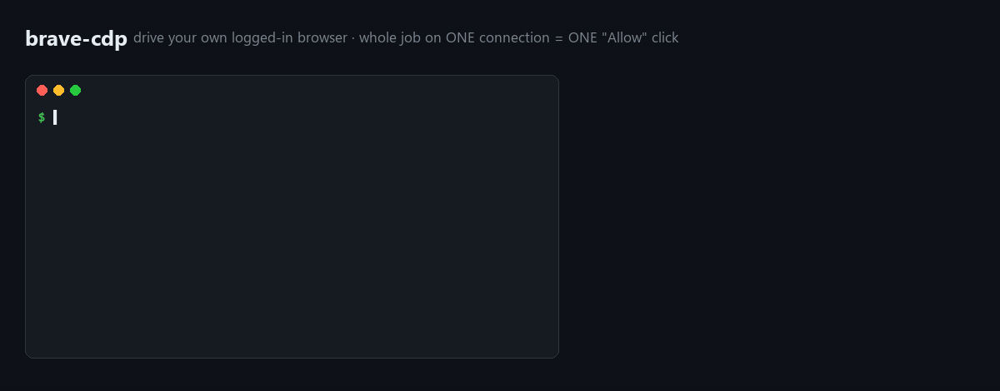
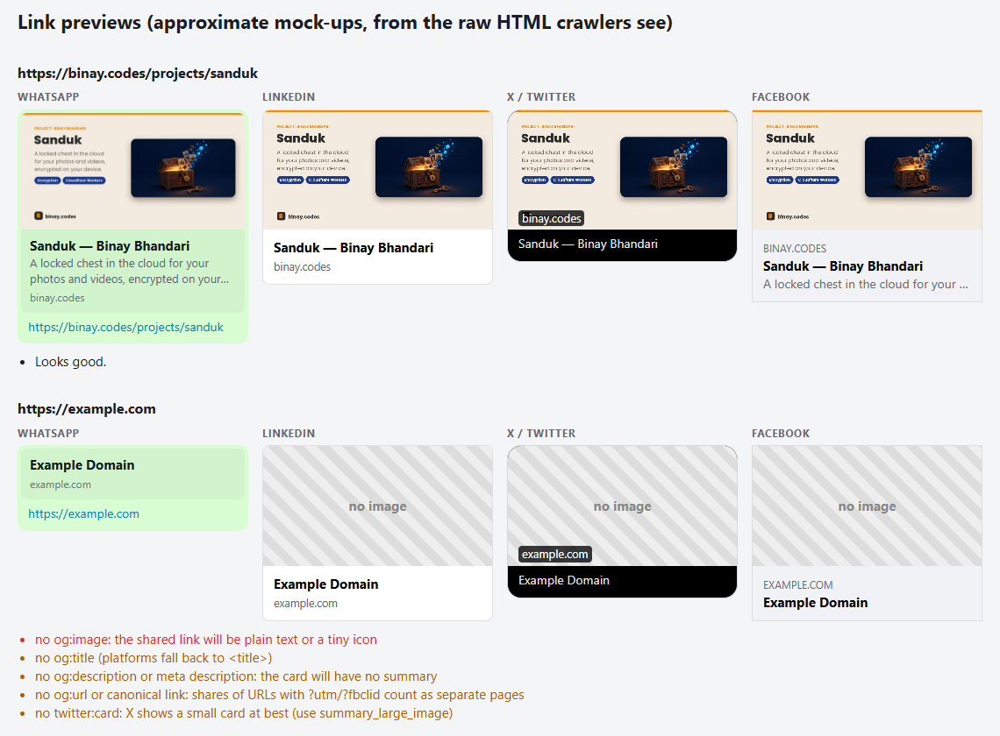

# claude-skills

**22 Claude Code skills that keep Claude Code safe and cheap, and help you ship websites, web games, videos and client work.** Each one is a small zero-dependency script plus a SKILL.md, tested against real projects (not toy demos) before it landed here.

[](LICENSE)   



## Install and quick start

In Claude Code:
```
/plugin marketplace add binay-py/claude-skills
/plugin install binay-skills@binay-skills
```
Then just ask in plain English. Claude picks the right skill:
- *"Is my Claude Code setup leaking any secrets?"* → claude-safety-audit
- *"Where are my usage limits going?"* → claude-token-audit
- *"Check my site before I send it to the client."* → site-qa, link-preview-check
- *"Package this game for itch.io."* → itch-html5-package

Or copy a single folder from `skills/` into `~/.claude/skills/`. Every script also runs on its own with Node 22+, e.g. `node skills/site-qa/scripts/site-qa.mjs https://example.com`.

## Keep Claude Code safe
| Skill | What it does |
|---|---|
| **[claude-safety-audit](skills/claude-safety-audit)** | Finds **API keys "Yes, and don't ask again" saved into your permission rules**, `settings.local.json` / `.mcp.json` committed to git (or still in history), `Bash(*)`, `git push:*` (which includes `--force`), bypass mode and missing deny rules. `--fix --apply` repairs them with backups. Never prints a secret. |
| **[bash-checkpoint](skills/bash-checkpoint)** | An **undo button for shell commands**: a hook that snapshots files before `rm`, `mv`, `git clean`, `sed -i`…, **blocks** `rm -rf ~` / `Remove-Item -Recurse C:\` (even inside `bash -c`), and asks before force-push and `reset --hard`. 37-case test suite included. |
| **[claude-sandbox](skills/claude-sandbox)** | Runs Claude Code in **Docker with only your project folder mounted**: non-root, all capabilities dropped, no sudo, `~/.claude` and SSH keys never visible. `--check` proves the isolation. |
| **[package-guard](skills/package-guard)** | Stops **hallucinated and typosquatted packages** ("slopsquatting"): a hook that checks every `npm i` / `pip install` against the registry, blocks names that don't exist, and asks about look-alikes and brand-new packages. |
| **[secret-commit-guard](skills/secret-commit-guard)** | A git **pre-commit hook that blocks commits containing keys and tokens** (any repo, not just Claude's), plus scans of the working tree and full history. 90-case test suite. |

## Keep Claude Code cheap
| Skill | What it does |
|---|---|
| **[claude-token-audit](skills/claude-token-audit)** | **Where do your limits go?** Tokens by project, session, model and day from your local logs, peak context per session, which tools flood the context, with specific fixes. 200 MB of logs in ~4 s. |
| **[read-guard](skills/read-guard)** | A hook that stops **whole-file reads of huge files and log dumps** and points Claude to Grep + a slice. Repeating the same call is allowed, so it never dead-ends. |
| **[session-handoff](skills/session-handoff)** | Writes a **HANDOFF.md** from the session (files, commands, decisions, next steps) so you can `/clear` and continue cheaply, plus a hook that warns when context passes 150k tokens. |
| **[mcp-audit](skills/mcp-audit)** | Lists every **MCP server** across scopes and plugins, how often each was actually used, duplicates, broken ones and secrets in config. `--measure` sizes each server's tool list in tokens. |
| **[claude-md-doctor](skills/claude-md-doctor)** | Shows **what loads into every session** and catches broken or too-deep `@imports`, CLAUDE.md over 200 lines, a truncated MEMORY.md, stale paths and scripts, and an ignored AGENTS.md. |

## Ship a website
| Skill | What it does |
|---|---|
| **[site-qa](skills/site-qa)** | Crawls a site in headless Chrome: **prioritized QA report** of JS errors, failed requests, broken images and links, mobile sideways-scroll, missing SEO/Open Graph tags, alt text, page weight, plus screenshots. |
| **[link-preview-check](skills/link-preview-check)** | How your URL looks when shared on **WhatsApp, LinkedIn, X and Facebook**, read the way their crawlers do (no JS). Catches bad og:images and **SPAs with the same title on every route**. |
| **[visual-diff](skills/visual-diff)** | **Before/after screenshots** around a deploy (desktop + mobile, animations frozen) with changed regions boxed and an HTML report. Exits 1 if anything moved more than the threshold. |
| **[cf-pages-deploy](skills/cf-pages-deploy)** | Deploys to **Cloudflare Pages** without leaking `.env`, `node_modules` or keys, then checks the live file matches **byte for byte**. |
| **[env-doctor](skills/env-doctor)** | Env vars the code reads vs `.env` / `.env.example`: undocumented, stale, unset, **secrets exposed to the browser** via `VITE_` / `NEXT_PUBLIC_`, and committed `.env` files. Never prints values. |

## Ship any repo
| Skill | What it does |
|---|---|
| **[release-notes](skills/release-notes)** | Keep-a-Changelog **release notes from git history** (conventional or free-form commits) with PR/commit links and a semver suggestion. `--write` updates CHANGELOG.md safely. |
| **[readme-upgrade](skills/readme-upgrade)** | Audits a README (sections, broken links, images, anchors, license) and with `--run` **executes its install/usage commands in a temp copy** to prove they work. |

## Ship a web game
| Skill | What it does |
|---|---|
| **[itch-html5-package](skills/itch-html5-package)** | Checks an HTML5 build against **itch.io's rules** and zips it right. Catches the `Player.png` vs `player.png` **case mismatch** that works on Windows but 403s on itch. |

## Win clients
| Skill | What it does |
|---|---|
| **[freelance-proposal](skills/freelance-proposal)** | Upwork proposals, Fiverr gigs and cold emails **from your real portfolio only**, then **scored**: template openers, AI-isms, placeholders, no proof, no question, ignoring the job post. |
| **[thumbnail-maker](skills/thumbnail-maker)** | **Bright, huge-text YouTube and social thumbnails** with a highlighted keyword and a photo card, plus a readability check at YouTube's tiny search size. |

 

## Drive your browser · Make a video
| Skill | What it does |
|---|---|
| **[brave-cdp](skills/brave-cdp)** | Claude drives **your own logged-in Brave / Chrome / Edge** on **one DevTools connection**, so you click "Allow remote debugging?" once instead of 20 times. |
| **[event-recap-video](skills/event-recap-video)** | Hundreds of phone photos and videos from an event → a hooky 16:9 recap, a 9:16 version and a **beat-synced** reel. ffmpeg + Python. |

## link-preview-check: see your link the way WhatsApp sees it

```bash
node skills/link-preview-check/scripts/preview-check.mjs https://example.com /about /pricing
```

Real output, a page with proper tags vs one without:



## Bugs these caught on real projects
- **mcp-audit:** of 18 configured MCP servers, only one had been called in 30 days; one named "fetch" was actually the MCP protocol *test* server; nine were identical duplicates in a project scope.
- **claude-token-audit:** one session peaked at 866k tokens of context, and `Read` produced 57% of all tool output. That's what read-guard and session-handoff fix.
- **bash-checkpoint:** a real `rm -rf src` was restored, including an *uncommitted edit* and a *brand-new untracked file*. Running the hook live also exposed (and fixed) false alarms on commit messages that merely mention dangerous commands.
- **link-preview-check / site-qa:** a Vite SPA portfolio served the homepage title on every route. The fix (per-route static HTML from a tiny Vite plugin) is written up in the skill.
- **itch-html5-package:** a three.js game hung forever on itch.io because the YouTube Playables SDK thought itch's iframe was YouTube.
- **cf-pages-deploy:** `wrangler pages project create` (4.15x) goes through "Pages in Workers" and can create a Worker instead; the skill forces a classic Pages project.
- **env-doctor:** caught a `VITE_SUPABASE_SERVICE_ROLE_KEY`, a service key shipped to every browser.

## brave-cdp: why it exists

Brave (and Chrome 144+ and Edge) show an **"Allow remote debugging?"** dialog for *every new DevTools connection*. Agents fire off many small scripts, so you end up clicking Allow over and over. brave-cdp runs the whole task as **one job on one connection**, or keeps one approved connection open with a token-protected **relay**:

```bash
cd skills/brave-cdp/scripts
node cdp.mjs tabs                                      # list tabs
node cdp.mjs eval "document.title" --match github.com
node cdp.mjs run job.mjs                               # whole task, one connection
```

## Contributing

Issues and PRs welcome, especially "this broke on my setup" reports from macOS and Linux. If a skill saved you time, a ⭐ helps others find it.

## License

MIT
