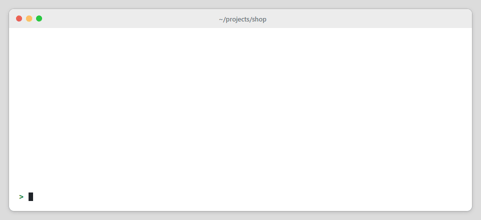
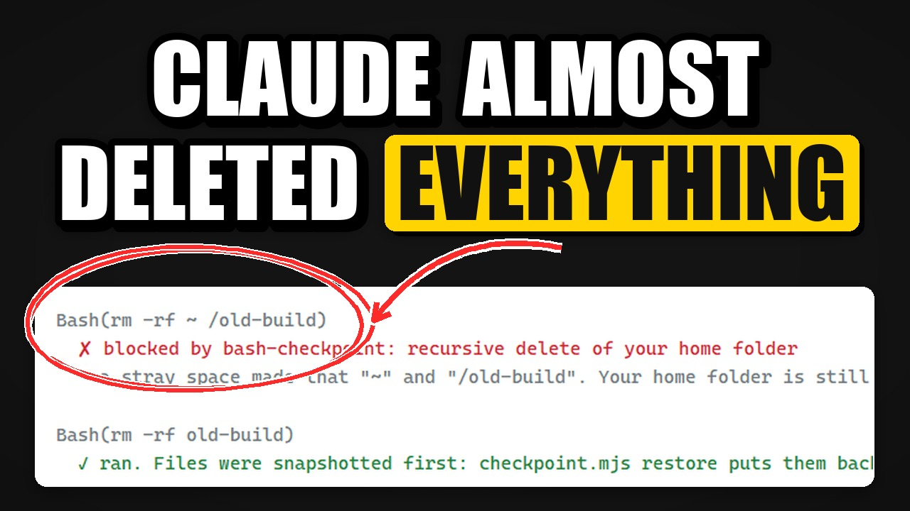
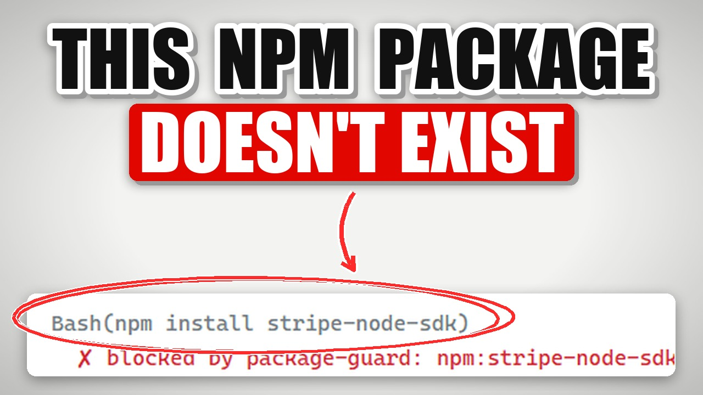

# claude-skills

A collection of 23 skills for [Claude Code](https://claude.com/claude-code). Some are guardrails that stop risky commands, hallucinated packages and leaked keys. Some cut token usage. The rest are tools for shipping websites, repos, games and media.

[](LICENSE)
[](https://nodejs.org)
[](https://github.com/binay-py/claude-skills/stargazers)



<sub>Real output from two of the hooks: a stray-space `rm -rf` and a hallucinated npm package, both blocked.</sub>

## Contents

- [Installation](#installation)
- [Enabling the hooks](#enabling-the-hooks)
- [Skills](#skills): [Safety](#safety) · [Usage and cost](#usage-and-cost) · [Websites](#websites) · [Repositories and games](#repositories-and-games) · [Media](#media) · [Freelance and browser](#freelance-and-browser)
- [Examples](#examples)
- [Design principles](#design-principles)
- [Contributing](#contributing)

## Installation

Install everything as a Claude Code plugin:

```
/plugin marketplace add binay-py/claude-skills
/plugin install binay-skills@binay-skills
```

Or copy a single folder from `skills/` into `~/.claude/skills/`. Each skill is a `SKILL.md` plus a script, and every script also runs on its own:

```bash
node skills/site-qa/scripts/site-qa.mjs https://example.com
```

Claude picks a skill from a normal request. For example, *"Is my Claude Code setup leaking any secrets?"* uses claude-safety-audit, and *"Where are my usage limits going?"* uses claude-token-audit.

### Requirements

| Needed for | Requirement |
|---|---|
| All skills | Node.js 22 or newer. No npm packages are installed. |
| site-qa, visual-diff, gif-maker | Chrome, Edge, Brave or Chromium (run headless with a temporary profile) |
| gif-maker, event-recap-video | ffmpeg |
| thumbnail-maker, event-recap-video | Python 3 with Pillow |
| claude-sandbox | Docker |
| cf-pages-deploy | A Cloudflare account (wrangler runs through `npx`) |

## Enabling the hooks

Four skills include a hook. Hooks are **off until you add them** to `~/.claude/settings.json` (all projects) or `.claude/settings.json` (one project). Each skill's `SKILL.md` has the exact snippet. For example:

```json
{
  "hooks": {
    "PreToolUse": [
      { "matcher": "Bash|PowerShell",
        "hooks": [{ "type": "command", "command": "node \"/path/to/skills/bash-checkpoint/scripts/checkpoint.mjs\" hook" }] }
    ]
  }
}
```

| Hook | Runs on | Does |
|---|---|---|
| bash-checkpoint | Bash, PowerShell | Snapshots files before destructive commands, blocks catastrophic ones, asks before force-push |
| package-guard | Bash, PowerShell | Checks package installs against the npm and PyPI registries |
| read-guard | Read, Bash, PowerShell | Stops whole-file reads of very large files |
| session-handoff (`meter`) | Stop | Warns when the session context passes 150k tokens |

All hooks fail open: if a hook errors or times out, the command runs normally.

## Skills

Type: **Hook** runs automatically once enabled · **CLI** is a script Claude (or you) runs · **Guide** is mostly instructions for Claude.

### Safety

| Skill | Type | Description |
|---|---|---|
| [claude-safety-audit](skills/claude-safety-audit) | CLI | Finds secrets saved into permission rules by "Yes, and don't ask again", Claude settings committed to git, over-broad rules such as `Bash(*)`, and missing deny rules. Optional fixes with backups. |
| [bash-checkpoint](skills/bash-checkpoint) | Hook, CLI | Undo for shell commands: snapshots before `rm`, `mv`, `git clean` and similar, blocks `rm -rf ~`, asks before `git push --force`. |
| [package-guard](skills/package-guard) | Hook, CLI | Blocks packages that don't exist and asks about typosquats and very new packages before `npm install` or `pip install`. |
| [secret-commit-guard](skills/secret-commit-guard) | Git hook | Pre-commit hook that blocks keys and tokens from being committed, plus working-tree and history scans. |
| [claude-sandbox](skills/claude-sandbox) | CLI | Runs Claude Code in Docker with only the project folder mounted, as a non-root user with no capabilities. |

### Usage and cost

| Skill | Type | Description |
|---|---|---|
| [claude-token-audit](skills/claude-token-audit) | CLI | Token usage by project, session, model and day from local logs, with the tools and sessions that cost the most. |
| [read-guard](skills/read-guard) | Hook | Points Claude to Grep and partial reads instead of loading very large files whole. |
| [session-handoff](skills/session-handoff) | CLI, Hook | Writes a HANDOFF.md so a long session can continue in a fresh, cheaper one. |
| [mcp-audit](skills/mcp-audit) | CLI | Lists MCP servers across scopes and plugins with real usage, duplicates, failures and token cost. |
| [claude-md-doctor](skills/claude-md-doctor) | CLI | Checks CLAUDE.md, rules, imports and memory files for size limits, broken imports and stale references. |

### Websites

| Skill | Type | Description |
|---|---|---|
| [site-qa](skills/site-qa) | CLI | Crawls a site and reports JS errors, broken links and images, mobile overflow, missing SEO and Open Graph tags, with screenshots. |
| [link-preview-check](skills/link-preview-check) | CLI | Shows how a URL previews on WhatsApp, LinkedIn, X and Facebook, and flags missing or broken tags. |
| [visual-diff](skills/visual-diff) | CLI | Before/after screenshots of a site with changed regions highlighted in an HTML report. |
| [cf-pages-deploy](skills/cf-pages-deploy) | CLI | Deploys to Cloudflare Pages from a clean copy, scans for secrets, and verifies the live files. |
| [env-doctor](skills/env-doctor) | CLI | Compares environment variables in code with `.env` files, including secrets exposed to the browser. |

### Repositories and games

| Skill | Type | Description |
|---|---|---|
| [release-notes](skills/release-notes) | CLI | Release notes and CHANGELOG entries from git history, with links and a semver suggestion. |
| [readme-upgrade](skills/readme-upgrade) | CLI | Audits a README's structure and links, and can run its commands in a temporary copy to verify them. |
| [itch-html5-package](skills/itch-html5-package) | CLI | Checks an HTML5 game against itch.io's upload rules and builds the zip. |

### Media

| Skill | Type | Description |
|---|---|---|
| [gif-maker](skills/gif-maker) | CLI | GIFs from HTML animations, terminal sessions, video clips or images, sized to a file-size budget. |
| [thumbnail-maker](skills/thumbnail-maker) | CLI | YouTube and social thumbnails: a large title over a real screenshot (circled and annotated) or a cut-out photo, with readability checks. |
| [event-recap-video](skills/event-recap-video) | CLI, Guide | Turns event photos and videos into a recap video, a vertical version and a beat-synced reel. |

### Freelance and browser

| Skill | Type | Description |
|---|---|---|
| [freelance-proposal](skills/freelance-proposal) | Guide, CLI | Writes proposals from a real portfolio and scores them for generic openers, missing proof and relevance. |
| [brave-cdp](skills/brave-cdp) | CLI | Lets Claude control your own Brave, Chrome or Edge over one DevTools connection. |

## Examples

<details>
<summary>link-preview-check: a page with Open Graph tags compared with one without</summary>
<br>

</details>

<details>
<summary>thumbnail-maker: real screenshots, circled and annotated</summary>
<br>


</details>

<details>
<summary>brave-cdp: a complete browser task on one connection</summary>
<br>

</details>

## Design principles

- **No dependencies.** Each script uses only Node's standard library (Python and Pillow for the image skills).
- **Read-only by default.** Anything that changes files or settings needs an explicit flag and keeps a backup.
- **Secrets stay hidden.** Tools that look for keys never print more than the first few characters.
- **Hooks never trap you.** They fail open, and read-guard always allows a repeated request.
- **Tested on real projects.** Each skill was run against real repositories and sites before release. Three include test suites you can run (`node tests/run.mjs`).

## Contributing

Bug reports and pull requests are welcome, especially from macOS and Linux users, since most testing so far was on Windows. Please include the command you ran and its output.

## License

[MIT](LICENSE) © 2026 Binay Bhandari
